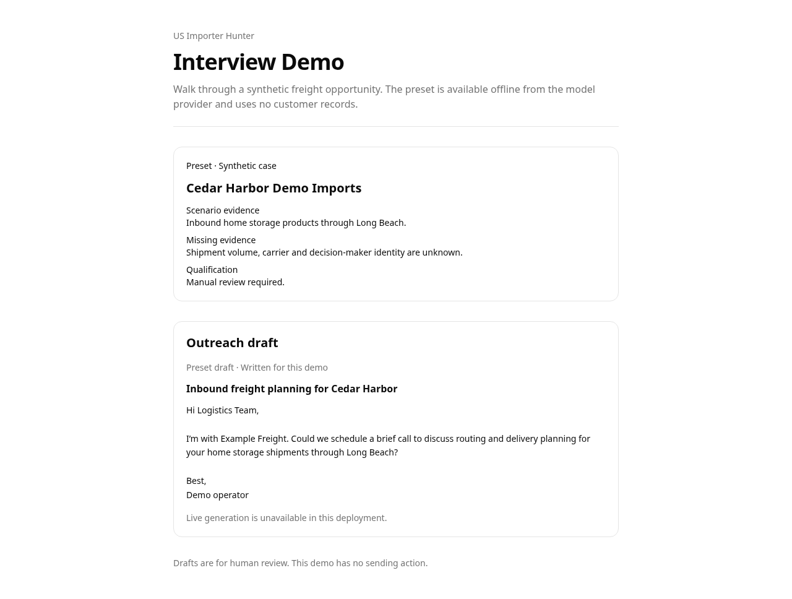
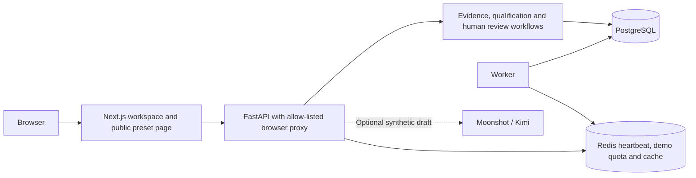

# US Importer Hunter

AI-powered sales intelligence for international freight forwarders —
a workflow for discovering, qualifying and prioritizing US importers, then
preparing outreach drafts for human review. **Status: internal beta.**

**FastAPI · Python 3.12 · Next.js 16 · PostgreSQL · Redis · OpenAI**

## Quick start

```bash
cp .env.example .env          # Fake email provider works without an OpenAI key

# full stack (requires Docker)
docker compose up --build     # frontend :3000 · backend :8000 · docs :8000/docs

# or on the host
make infra                    # postgres + redis in Docker
make backend                  # FastAPI with hot reload
make frontend                 # Next.js dev server
```

Open <http://localhost:3000/interview-demo> for the synthetic interview case,
or <http://localhost:3000> for the single-page MVP workspace. Submit a company with
real evidence sources, inspect the qualification and draft, approve it, then use
**Refresh result** (or reload the `?company_id=...` URL) to verify persistence.
The UI never sends email. Browser API access always uses same-origin
`/api/v1/*`; the Next.js server reads `BACKEND_INTERNAL_URL` at runtime.

## Interview demo



The public demo page is limited to a fictional company, fixed evidence and a
draft preview. In production the workspace and business APIs still require the
frontend passcode. The demo labels the draft source:

| Source | Meaning |
| --- | --- |
| Preset | A hand-written example bundled with the UI. It works without a model key. |
| Cached Kimi result | A previous Kimi response for the fixed case and configured model, kept for up to 24 hours. |
| Live Kimi generation | A new response from the Moonshot API for that fixed synthetic input. |

Live generation defaults off. After approval, set the backend-only
`KIMI_API_KEY`, `KIMI_MODEL` (default `moonshot-v1-8k`), and
`KIMI_DEMO_MAX_ATTEMPTS` (0–10). Redis reserves a shared attempt before the
provider request. It allows one attempt per minute and a deployment-wide
total per persistent Redis store. The adapter sends a fixed prompt, caps
output at 450 tokens, and disables SDK retries. Attempt and token limits
bound requests. Configure a provider-side budget for a currency limit.
Keep the quota store persistent and use a no-eviction policy for an
external Redis instance. Clearing that store resets the allowance.

### Architecture



### Verification and limits

- The local health check at `/api/v1/health` covers process liveness. Check the
  JSON `status` from `/api/v1/health/ready` for PostgreSQL, Redis and worker
  heartbeat. For production Compose, authenticate to these endpoints through
  the frontend passcode.
- The July 2026 [engineering evaluation](docs/validation/v0.2-real-company-evaluation.md)
  used an engineer-selected sample of 10 public company websites. Reviewers
  accepted 48 claims and edited 5. One of the 10 sites yielded no claims.
  These figures describe that website-research evaluation. Customer outcomes
  and Kimi output quality have yet to be measured.
- The interview demo previews an opportunity and draft. The internal workspace
  handles CSV ingestion, evidence promotion, scoring, contact selection and
  named approval. Email sending and public access to internal records remain
  outside the demo.

## Website research (v0.2.0 — Internal Beta)

Give the research panel a company name and its website; it fetches the site
safely, extracts evidence-backed claims, and waits for a human to accept, edit
or reject each one. Every claim carries the sentence that supports it and the
page it came from. Research never creates a Company, never scores, and never
sends email — accepted claims only fill the existing prospect form.

The panel is an internal testing surface: it is off unless
`NEXT_PUBLIC_ENABLE_RESEARCH=true`, and **the Research API must not be exposed
anonymously on the public internet**. Extraction defaults to a Fake provider;
a real model requires `RESEARCH_EXTRACTOR_PROVIDER=openai`.

> **Changing any `NEXT_PUBLIC_*` value requires rebuilding the frontend.**
> Next.js compiles these into the client bundle, so restarting the container
> is not enough — the old value is already baked in:
>
> ```bash
> docker compose build --no-cache frontend && docker compose up -d frontend
> ```
>
> This applies only to `NEXT_PUBLIC_ENABLE_RESEARCH`. Backend routing is a
> server-only runtime setting and does not require rebuilding the frontend.

Validation and known limitations:
[docs/validation/](docs/validation/v0.2-real-company-evaluation.md) ·
[release notes](docs/release-notes.md).

## Documentation

- **[PROJECT.md](PROJECT.md)** — the project document: vision, MVP,
  architecture, workflow, sprints, progress, roadmap. **Start here.**
- [docs/](docs/) — detailed references: PRD, business domain, architecture,
  coding standards, agents, workflows, API, database, decision log (ADRs),
  roadmap.
- [docs/deployment.md](docs/deployment.md) — production deployment on any
  server (Docker Compose) or container platform.
